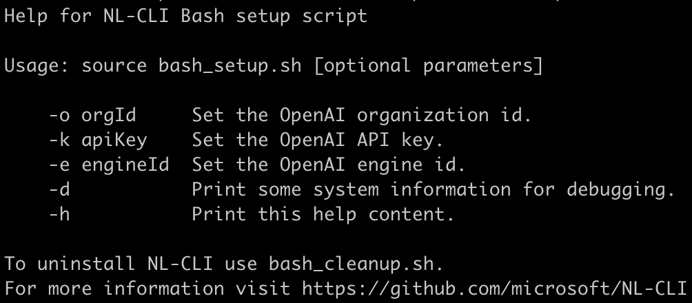

# Codex CLI Installation

In order to leverage the Codex CLI tool, you will need to prepare your environment for the shell of your choice. Installation instructions are shown below for each supported shell environment. 

The following terminal environments are supported:  

* [Powershell](#powershell-instructions)
* [Bash](#bash-instructions) 
* [Zsh](#zsh-instructions) (or [Bash 5.1](#bash-instructions))

Learn to install PowerShell on Linux/MacOS
[here](https://docs.microsoft.com/powershell/scripting/install/installing-powershell).

## Prerequisites

In order to run the Codex CLI, ensure that you have python installed. To install the required python packages, please go to the command line in the shell of your choice and enter the following commands: 

```
python -m pip install -r requirements.txt
```

Additionally, a MiniMax API key, API base URL, and model id are required to execute the Codex CLI tool. An organization id is optional.

## MiniMax configuration

The setup scripts accept an API base URL and model id. Use one of these regional base URLs:

* Global: `https://api.minimax.io/v1`
* China: `https://api.minimaxi.com/v1`

The current model ids are `MiniMax-M3.1-Flash` (recommended) and `MiniMax-M3`. For example:

```bash
source bash_setup.sh -k YOUR_API_KEY -b https://api.minimax.io/v1 -m MiniMax-M3.1-Flash
```

The generated `src/openaiapirc` stores `base_url` and `model`; `organization_id` is optional. When editing this file manually, omitting or leaving `model` blank selects `MiniMax-M3.1-Flash` for either direct MiniMax base URL. Explicit model ids and the legacy `engine` alias take precedence; custom endpoints require an explicit model.

## Bash instructions

To leverage the Codex CLI on WSL and Linux environments using Bash please follow the steps below: 

1. Open Bash shell and download the Codex CLI project to your desired location in Linux by cloning the Codex CLI repo using the following command: 
    ```
    $ git clone https://github.com/microsoft/Codex-CLI.git /your/custom/path/
    ```

2. Once you have the project cloned. Go to the directory that contains the Codex CLI code.
    ```
	cd </your/custom/path>/Codex-CLI
    ```

3. Setup your Bash Codex CLI environment.

	In the Codex CLI folder, there is a folder named `scripts` where you will find a `bash_setup.sh` script which is used to setup the Bash environment.

	Run the following commands to setup your environment, the script will prompt
	for an optional organization id, API key, API base URL, and model id:
	```
	cd scripts
	source bash_setup.sh
	```
	
	The script will create an OpenAI config file and update your bash environment.

4. Open a new Bash terminal. Type in `#` followed by your natural language request. Press `Ctrl + G` to execute!

### Clean up

Once you have finished using the Codex CLI tool, go to the folder that contains the Codex CLI code. ex `cd ~/your/custom/path/Codex-CLI`. Run the following command to clean up the Codex CLI bash environment.
```
source ./scripts/bash_cleanup.sh
```
Once done, close the terminal session.

### About bash_setup.sh

By default `bash_setup.sh` will prompt for the required settings. It's also possible to pass these values from the command line, using the following parameters:

| Parameter    | Description |
|--------------|-------------|
| `-o <value>` | To pass your [OpenAI Organization Id](https://beta.openai.com/account/org-settings) |
| `-k <value>` | To pass your API key |
| `-b <value>` | To specify the API base URL |
| `-m <value>` | To specify the model id |
| `-e <value>` | Legacy alias for `-m` |

Example: 

```
source bash_setup.sh -k YOUR_API_KEY -b https://api.minimax.io/v1 -m MiniMax-M3.1-Flash
```

For help running the Codex CLI Bash setup, please run the following command:   
```
source bash_setup.sh -h
```



## Zsh instructions

1. Download this project to `~/your/custom/path/`.

```
$ git clone https://github.com/microsoft/Codex-CLI.git ~/your/custom/path/
```

2. In zsh, go to `~/your/custom/path/` (the folder contains Codex CLI code), then run the following command to setup your zsh environment. The script will prompt for an optional organization id, API key, API base URL, and model id:

```
./scripts/zsh_setup.sh
```
&nbsp;&nbsp;&nbsp;&nbsp;&nbsp;&nbsp;&nbsp;&nbsp;&nbsp;&nbsp;See [About zsh_setup.sh](#about-zshsetupsh) section to learn script parameters.

3. Run `zsh`, start typing and complete it using `^G`!

### Clean up
Once you are done, go to `~/your/custom/path/` (the folder contains Codex CLI code), then run the following command to clean up.
```
./scripts/zsh_cleanup.sh
```

### About zsh_setup.sh
`zsh_setup.sh` supports the following parameters:
| Parameter    | Description |
|--------------|-------------|
| `-o <value>` | To pass your [OpenAI Organization Id](https://beta.openai.com/account/org-settings) |
| `-k <value>` | To pass your API key |
| `-b <value>` | To specify the API base URL |
| `-m <value>` | To specify the model id |
| `-e <value>` | Legacy alias for `-m` |


## Powershell instructions

1. Download this project to wherever you want. For example, `C:\your\custom\path\` or `~/your/custom/path`.

```PowerShell
git clone https://github.com/microsoft/Codex-CLI.git C:\your\custom\path\
```

2. Open PowerShell and run the following command. If running in Windows, start PowerShell "as an Administrator".

```PowerShell
Set-ExecutionPolicy RemoteSigned -Scope CurrentUser
```

For more information about Execution Policies, see
[about_Execution_Policies](https://docs.microsoft.com/powershell/module/microsoft.powershell.core/about/about_execution_policies).


3. In the same Powershell terminal, go to `C:\your\custom\path\Codex-CLI\` (the folder that contains the cloned Codex CLI project). Run the command below with your API base URL and model id. It will prompt you for an API key.

```PowerShell
.\scripts\powershell_setup.ps1 -OpenAIApiBaseUrl 'https://api.minimax.io/v1' -OpenAIModelId 'MiniMax-M3.1-Flash'
```
&nbsp;&nbsp;&nbsp;&nbsp;&nbsp;&nbsp;&nbsp;&nbsp;&nbsp;&nbsp;See [About powershell_setup.ps1](#about-powershell_setupps1) section to learn script parameters.

4. Open a new PowerShell session, type in `#` followed by your natural language command and hit `Ctrl + G`!

### Clean up
Once you are done, go to `C:\your\custom\path\` (the folder that contains the cloned Codex CLI project), then run the following command to clean up.
```
.\scripts\powershell_cleanup.ps1
```

If you want to revert the execution policy, run this command
```
Set-ExecutionPolicy Undefined -Scope CurrentUser
```

### About powershell_setup.ps1
`powershell_setup.ps1` supports the following parameters:
| Parameter | Type | Description |
|--|--|--|
| `-OpenAIApiKey` | [SecureString](https://docs.microsoft.com/en-us/dotnet/api/system.security.securestring) | Required. If is not supplied, the script will prompt you to input the value. You can find this value at [https://beta.openai.com/account/api-keys](https://beta.openai.com/account/api-keys). To provide the value via PowerShell parameter, this is an example for PowerShell 7: <br/> `.\scripts\powershell_setup.ps1 -OpenAIApiKey (ConvertTo-SecureString "YOUR_OPENAI_API_KEY" -AsPlainText -Force)` | 
| `-OpenAIOrganizationId` | String | Optional organization id. |
| `-OpenAIApiBaseUrl` | String | Required API base URL. |
| `-OpenAIModelId` | String | Required model id. `-OpenAIEngineId` remains available as an alias. |
| `-RepoRoot` | [FileInfo](https://docs.microsoft.com/en-us/dotnet/api/system.io.fileinfo) | Optional. Default to the current folder.<br>The value should be the path of Codex CLI folder. Example:<br/>`.\scripts\powershell_setup.ps1 -RepoRoot 'C:\your\custom\path'`|
